# LLEVAR – Alex Soft

**Modular system for file transfer and compression on Windows.**  
PowerShell 7 · USB · FTP · OneDrive · Dropbox · ISO · Block splitting

<p align="center">
  
</p>

---

## 🚀 ¿Qué es LLEVAR?

**LLEVAR** es un sistema modular para **transferencia, compresión y división de archivos en Windows**, diseñado para mover datos grandes de forma flexible entre distintos medios y destinos.

Permite:
- Copiar y transferir archivos
- Comprimir contenido
- Dividir archivos en bloques
- Preparar datos para USB, FTP, nube o ISOs
- Automatizar flujos reales con PowerShell 7

---

## ⚡ Quick start

```powershell
.\Llevar.ps1 -Source "C:\Data" -Target "D:\Backup" -Compress -Split
```

> Requiere **PowerShell 7+**.  
> En algunos entornos, PowerShell puede bloquear la ejecución de scripts descargados.
> En ese caso, podés habilitarlo solo para la sesión actual:
>
> ```powershell
> Set-ExecutionPolicy -Scope Process -ExecutionPolicy Bypass
> ```
> Esto no modifica la configuración del sistema ni se mantiene al cerrar la consola.

---

## 📚 Documentación

- [Índice de la documentación](Docs/README.md)
- [Integración con OneDrive](Docs/ONEDRIVE-README.md)
- [Configuración de transferencias (TransferConfig)](Docs/TRANSFERCONFIG.md)
- [Navegador de archivos](Docs/NAVEGADOR.md)
- [Banners y logos](Docs/BANNERS.md)
- [Validación de carga de módulos](Docs/MODULE-LOADER-VALIDATION.md)
- [Testing](Docs/TESTING.md)

También disponible en el [Wiki del proyecto](https://github.com/javiprieto89/Llevar/wiki).